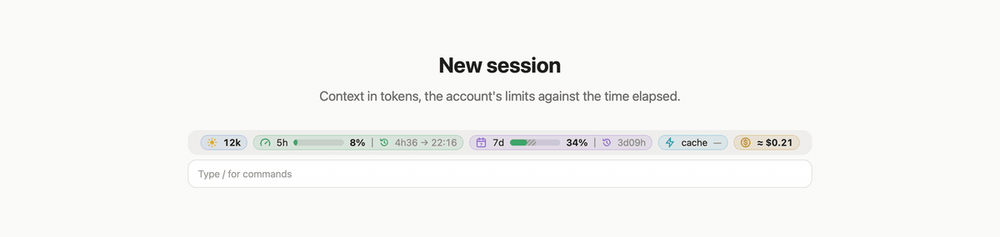
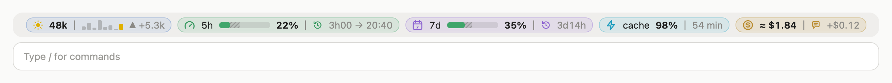
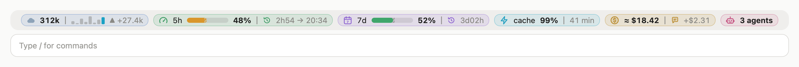
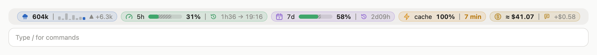
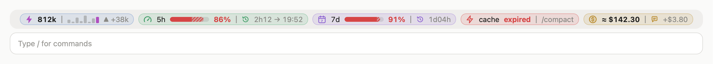
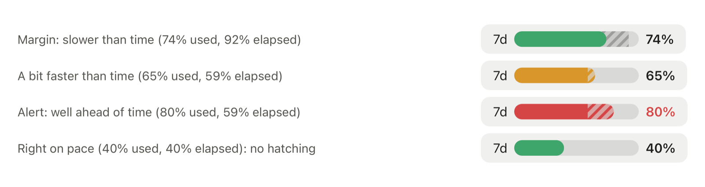

# claude-mods

[Claude Code](https://claude.dev/blog/getting-started-with-claude-code-mods/) mods by Eric Cologni.

## token-weather-usage

[](https://statuslin.es/mods/token-weather-usage)

Stop hitting your Claude limit by surprise. One band above the prompt shows how big your context is, your 5-hour and weekly limits against the clock (with a warning when the week's pace would run out before the reset), whether the prompt cache is still warm, what the session and the last prompt cost, and which agents are running.



### Four situations

**All clear.** Small context, both limits behind the clock, the cache warm for almost an hour.



**Agents at work.** Three subagents running (hover their pill for their tasks); the 5-hour limit runs a little ahead of time, so its gauge turns yellow.



**Cache about to lapse.** Seven minutes left: send the next message now, or the whole 604k context gets written again at full price.



**Slow down.** Context near full, the 5-hour limit far ahead of time, the cache expired: `/compact` before going on.



### What each pill says

| Pill | What it shows | Warns you when |
| --- | --- | --- |
| **Context** | Tokens in the context, the last 5 prompts as bars | The weather turns from Clear to "Compact soon" |
| **5h / 7d** | Share of each limit used, time left | Yellow when you run ahead of the clock, red when far ahead or past 90% |
| **Run-out** | When this week's pace would hit the 7-day limit | Amber "⚠ out Sun night", red within a day |
| **Cache** | Minutes before the prompt cache lapses | Yellow under 10 min, red once expired, with what it will cost |
| **Cost** | What the session cost, and the last prompt | Never: it just counts |
| **Agents** | Subagents running and run so far | Never: it just counts |

In the app, **hover any pill** for its details.

#### Context

- A weather icon from Clear to "Compact soon", then the tokens in the context.
- One bar per prompt for the last 5, as tall as the tokens it added; the current one in color.
- The last prompt's change ("▲ +6.3k").
- Hover: the weather and the share of the window.

#### 5h / 7d

- The share of your account's limits already used, then the time left.
- The hatched part is the gap with the time elapsed: grey after the bar while you have margin, in the bar's color when you use faster than time passes.



<details>
<summary>More detail</summary>

- Green while usage does not run ahead of time, yellow beyond, red when more than 15 points ahead or past 90%.
- The 5-hour reset time (machine's time zone) is in the pill's hover card in the app, left out in the terminal.
- A window that already reset is hidden until the next reading.
- The latest reading is shared across the sessions open on the machine.

</details>

#### Run-out warning

- Appears on the 7d pill when the week's pace would use up the limit **before** it resets: "⚠ out Sun night" in the terminal; in the app, a shorter "⚠ Sun pm" takes the place of the time left (the reset date stays in the hover card).
- Amber, red within a day.
- Hover: the exact time and the last day's pace, to tell whether you are speeding up or slowing down.
  > At this week's pace (+62% in 3d23h), the 7-day limit runs out Sun night around 00:42, before the reset on Mon 19/10.

<details>
<summary>More detail</summary>

- The pace is the share used since the week started over the time elapsed: the same projection as Claude's usage page.
- Hours after midnight belong to the night before ("nuit de dim. à lun." in French).
- Shown from the week's second day and 15% used; hidden when the terminal line is too narrow for details.

</details>

#### Cache

- The time before the prompt cache lapses: behind a bolt in the app, the word "cache" in the terminal.
- Each message restarts the clock: 1 hour on a Claude subscription, 5 minutes on an API key.
- **Under 10 minutes** (yellow): what is at stake ("$2.32 at stake"), the whole context written again if it lapses.
- **Expired** (red): what the next message writes again and its cost ("741k to rewrite ≈ $5.93").
- **Missed**: a message had to write the cache again; shows the cause (model changed, lapsed, start changed) and the extra cost ("+$2.10").
- **The way out**, from 100k tokens: `/compact` up to 300k, a new thread beyond.

<details>
<summary>More detail</summary>

- When the last message read less than 90% of its prompt from the cache, that share comes first ("cache 64% · 52 min").
- Mods get the token counts but not the lifetime, so the mod follows Claude Code's rules and corrects itself from what the traffic shows.
- Why a new thread beyond 300k: the next message would rewrite the whole context at full price, which a new thread avoids and a compaction would only read again. The terminal keeps the advice on the line ("· /compact", "· new thread"); the app puts it in the hover card.
- Hover: the expiry time, the share of the last message read from the cache, what the context costs read from the cache against written again, and what the cache saved in this thread.
- Prices: Anthropic's list prices dated 2026-10-08 (input, cache read, cache writes at 1.25× input for 5 minutes or 2× for 1 hour). On a subscription they are API-price equivalents, hence the "≈". A model missing from the price table shows tokens only.
- A compaction updates the band at once: the context drops to its new size, and the cache reads "compacted" until the next message writes a new one (not counted as a miss).

</details>

#### Cost

- What the session cost, as `/cost` totals it (cents dropped from $100; in the app, whole dollars on the pill and the cents in its hover card).
- What the last prompt added, subagents included, in dollars and in points of the 5-hour limit ("+$1.07 · +2.5% 5h").
- The app keeps the total in the pill and the last prompt in its hover card; the terminal writes both on the line.

<details>
<summary>More detail</summary>

- The 5-hour limit is the account's: other sessions running at the same time count in it.
- On a subscription the dollars are the API-price equivalent, not a bill, hence the "≈".

</details>

#### Agents

- How many subagents the thread ran ("2 running · 7" while some run).
- Hover: the cost split between the main thread and each model's agents, the agents still running with their latest tool, the last batch, and what delegating saved ("Delegating: ≈ $8.40 saved compared with Opus 5.5").

<details>
<summary>More detail</summary>

- For each model's agents: their cost, effort levels and tokens. Running agents show the name of their latest tool, never its arguments. The last batch: how long it took, how much ran in parallel, its tool calls and cost.
- Each subagent request is counted as it comes back, at list prices (output at 5× input, 5-minute cache writes assumed, Haiku 5.5 by prompt size); the main thread's share is the session cost less its agents'.
- The terminal shows the count once the thread has run one.
- Background shell commands are not counted (Claude Code does not expose them to mods).
- A workflow's agents (the Workflow tool) are not shown: Claude Code does not list them, and telling them apart from its own internal agents would take a hook on agent spawns, which the plugin directory does not accept. Their cost still counts in each model's line.
- The mod reads all this from the agents' responses: it never hooks a tool call, so it can neither slow one down nor stand in its way.

</details>

#### App and terminal

In the desktop app each block is a tinted pill with its icon. A pill never shrinks; when the window is too narrow, the pills wrap onto a second line. In the terminal the same blocks sit on one line, split by a thin rule:

```
☂ 634k ▃▄▂█▆ ▲ +6.3k │ 5h ━━━━╍─ 74% · 24 min │ 7d ━━━━── 65% · 2d20h │ cache 52 min │ ≈ $41.07 (+$0.58 · +1.5% 5h) │ 2 agents
```

When the line does not fit the terminal, the bars, details and cost drop out, leaving labels and percentages.

### Language

Labels are in English, French or Russian. By default (`auto`) the mod follows `LC_ALL`, `LC_MESSAGES` or `LANG` and falls back to English. The desktop app often sets none of them: pick `en`, `fr` or `ru` in the plugin's **Language** option in `/config`.

### Install

```
/plugin marketplace add augiefra/claude-mods
/plugin install token-weather-usage@augiefra-mods
/reload-plugins
```

This repository always has the latest version. The mod is also listed in the Claude plugin directory, but the copy there can be several versions behind, as each update waits for Anthropic's review.

If the line does not show up, restart Claude Code. A mod is code that runs inside Claude Code with the same access as Claude Code: read it before installing. This one is a single file, [token-weather-usage.mjs](plugins/token-weather-usage/hooks/token-weather-usage.mjs).

### Check

```
claude plugin validate ./plugins/token-weather-usage
claude plugin test ./plugins/token-weather-usage
```

## Privacy

token-weather-usage collects, sends and retains no personal data. It only reads the usage figures Claude Code provides (context fill, 5-hour and 7-day limits, session cost, each request's cache token counts), the list of the session's subagents and the names of the tools their responses ask for (never the arguments; shown in the agents card, kept in memory only and never stored), the locale variables above and the prompt-cache switches (`DISABLE_PROMPT_CACHING`, `FORCE_PROMPT_CACHING_5M`, `CLAUDE_CODE_PROMPT_CACHE_TTL`, `ENABLE_PROMPT_CACHING_1H`). It reads no file and hooks no tool call. It keeps in the plugin's local storage, on the machine, the latest limits reading, the 7-day share used every half hour over the last two days, and, per session, recent context readings, the last request's cache figures, what the cache saved in the session, the last prompt's cost and each subagent's model, effort, token counts and description (deleted after 8 idle days). No network requests.

**What its hooks do.** Every hook only reads and passes the event on unchanged (`return next(e)`): the mod never changes, delays or refuses anything. `session.start` and `session.end` start and stop its timers; `turn.step` reads each model response's token counts and the names of the tools it asks for; `turn.complete` reads the session's usage after each turn; `session.measure` reads new limits and cost readings; `session.compact` notes a compaction; `ui.render` draws the band above the prompt.

## Credits

- The context weather, the tokens and the turns chart come from Anthropic's **Token Weather** example ([claude-code-playground](https://github.com/anthropics/claude-code-playground), Apache-2.0).
- The limit gauges are inspired by HolyGrail's **usage-meter** ([HolyGrail/claude-mods](https://github.com/HolyGrail/claude-mods/tree/main/plugins/usage-meter)). They were written for this mod after usage-meter (same idea: gauges with an elapsed-time marker, a reading shared across sessions), without copying its code.
- The cache block is inspired by Daniel San's **prompt-cache-control** ([davila7/claude-code-templates](https://github.com/davila7/claude-code-templates), MIT). It was written for this mod after it (same idea: cache usage per request, an inferred lifetime, a countdown), without copying its code.
- The agents card's tool lines and last batch adapt code from Anji Xu's **agentpane** ([xuanji86/claude-agentpane](https://github.com/xuanji86/claude-agentpane), MIT): its batch grouping, batch receipt and tool naming. Its license is reproduced in [NOTICE](NOTICE).

## License

Apache-2.0, see [LICENSE](LICENSE) and [NOTICE](NOTICE).

## By the same author

[FacilAbo](https://www.facilabo.com): 230+ calendars (public and school holidays, tax deadlines, sport) to subscribe to in one tap, on [iPhone](https://apps.apple.com/fr/app/facilabo-de-200-calendriers/id6756318719) and [Android](https://play.google.com/store/apps/details?id=app.facilabo.android). EuroVolt, your Linky electricity use in euros, is coming soon on iPhone.
